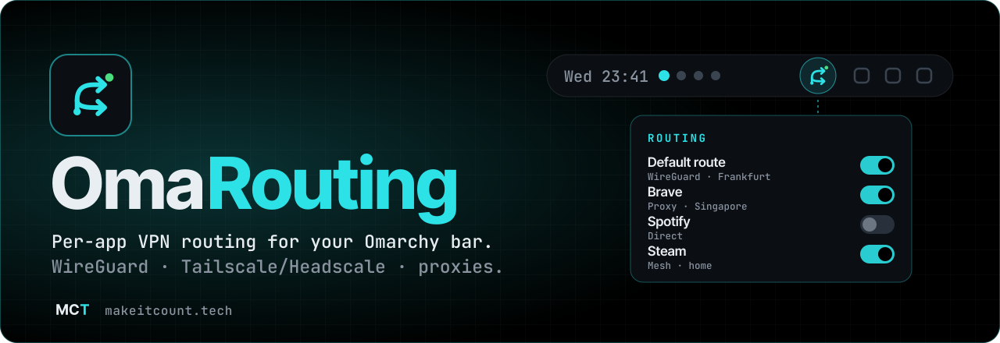

<p align="center">
  
</p>

<p align="center">
  <a href="LICENSE"></a>
  
  
  
  <a href="https://github.com/makeitcounttech/omarouting/stargazers"></a>
</p>

<p align="center">
  <b>Decide which app goes through which tunnel, from one click in your top bar.</b><br>
  WireGuard, Tailscale/Headscale and proxies, side by side. No terminal, no config juggling.
</p>

---

## ✦ Why OmaRouting

Most VPN tools are all-or-nothing: everything goes through the tunnel or nothing does. OmaRouting lets you route **per application**. Your browser can exit in Singapore while Steam stays direct and a work app rides your private network. Everything is controlled from the Omarchy bar.

<table>
<tr>
<td width="50%" valign="top">

### 🧭 Per-app & default routing
Pick a **default route** for the whole machine, then add **application exceptions**. Each installed app can go direct, through a VPN, or through a proxy.

### 🌍 Country → City → Server
Browse your providers geographically and switch exits in seconds. You can also let OmaRouting pick the first available server.

### 🛡️ Kill switch & safe capture
Block selected routes when a tunnel drops. Host-wide capture sits behind its own independent safety gate, so it never switches on by accident.

</td>
<td width="50%" valign="top">

### 🔌 Bring your own connections
Import **WireGuard** (`.conf` / `.zip`), join **Tailscale** or **Headscale**, or add **SOCKS5 / HTTP / HTTPS** proxies. TLS verification always stays on. It also detects duplicates on import.

### 🧪 Managed browser profiles
Spin up **separate browser profiles**, each pinned to its own route. You keep clean identities without touching your main browser.

### 📊 Honest status
Live latency, uptime and observed routes. OmaRouting shows **what is actually happening**, not just what you configured.

</td>
</tr>
</table>

## ⚡ Quick start

> [!IMPORTANT]
> OmaRouting is the **bar frontend**. It drives a local sing-box routing backend (`singbox-runtime`, `singbox-connections` and their systemd services). That backend is **not part of this repository**, so install and review it separately first.

```bash
# 1. Back up any existing copy, then install the plugin
mkdir -p ~/.config/omarchy/plugins/community.singbox-vpn
git clone https://github.com/makeitcounttech/omarouting.git /tmp/omarouting
rsync -a --exclude '.git' --exclude '.github' --exclude 'scripts' --exclude 'tests' \
  /tmp/omarouting/ ~/.config/omarchy/plugins/community.singbox-vpn/
```

2. Open **Omarchy → Plugins** and enable **OmaRouting**.
3. Click the routing icon in the bar, then **Settings → Connections → Add connection**, and import your provider.
4. Choose a **default VPN**, add your **application exceptions**, and you're done.

Autoconnect is **opt-in**. Enable `singbox-vpn-autoconnect.service` only once your backend is verified.

## 🧩 Requirements

| | |
|---|---|
| **Desktop** | [Omarchy](https://omarchy.org) 4.x (Hyprland + Quickshell) |
| **Runtime** | Python 3, systemd |
| **Backend** | A compatible local sing-box routing broker (separate install) |

## 🔒 Privacy by design

Your credentials and runtime state live **outside** the plugin folder and never enter source control. Every commit in this repository goes through an automated privacy scan and [gitleaks](https://github.com/gitleaks/gitleaks) in CI.

<details>
<summary><b>Development checks</b></summary>

```bash
bash scripts/privacy-scan.sh
python -B scripts/lint.py
gitleaks dir . --redact
```
Tooling: Python 3.13, Node.js, ruff 0.17.2, shellcheck-py 0.11.0.1, gitleaks 8.30.1. QML lint runs when `qmllint` and its Quickshell imports are available.
</details>

<details>
<summary><b>Uninstall</b></summary>

Disable the plugin in Omarchy first, then remove `~/.config/omarchy/plugins/community.singbox-vpn/`. Don't stop a routing service while host capture is active.
</details>

## 📜 License

MIT © [makeitcount.tech](https://makeitcount.tech). [sing-box](https://github.com/SagerNet/sing-box) is a separate GPL-3.0 project and is neither bundled nor linked. Omarchy and Quickshell provide the shell runtime.

---

<p align="center">
  <a href="https://makeitcount.tech"></a><br>
  <sub><b>Build a digital life you control.</b> · More from us: <a href="https://github.com/makeitcounttech/omatainment">OmaTainment</a></sub>
</p>
